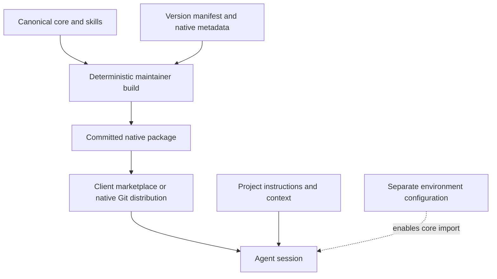

# Architecture

## Components and data flow

`toolkit.json` enumerates version, sources, three independent skills, one adapter, and zero runtime dependencies. Canonical Markdown/Agent Skills describes behavior; native metadata describes delivery. Build copies bytes into the Claude package and creates a SHA-256 inventory. Generated files are committed so clients need no build tools. CI rejects drift. There is no runtime dependency resolver or workflow interpreter.

The core has 30–50 lines and is imported separately. Skills progressively load focused procedures. [Adaptive workflow](../workflows/adaptive.md) defines Small/Medium/Large and is an on-demand reference, not an extra always-on document. Agents should not silently assume this reference was loaded.

## Sources of policy

Host system/developer policies remain authoritative. User authorization and project contracts are preserved. Toolkit defaults fill gaps; they do not establish a universal client precedence model. Avoid conflicting duplicated core imports. Actual file loading and invocation semantics belong to each adapter.

Durable context contains inspected stack, check commands, boundaries, conventions, and decisions with source links and inspected commit. Prefer existing documents. Task context contains ticket, AC, scope, branch/base, findings, check outcomes, and next step. Recheck it on resume. Conversation output is the default; file creation is deliberate. User-owned instruction edits require explicit authorization.

## Distribution and version contract

Git is the version source. SemVer describes toolkit behavior; changed obligations or removed skill interfaces require a major version after 1.0. During 0.x, minor releases may change behavior and must document migration. Each release records a commit, generated package, checksums, supported client versions, and changelog. Mutable tags are forbidden by release policy; checksums alone do not prove authenticity.

Each client receives a thin native package. The initial bundle offers three independent skills; future language modules remain opt-in. No universal plugin format is required. Build refuses symlinks, unsafe source paths, version mismatches, and unknown output files. It never installs or merges user configuration.

Overrides live outside upstream/cache files. Upgrades replace package content through the client. Changes to global core imports and their pinned checkout are explicit configuration work. No automatic update is enabled by toolkit.

## Engineering principles

Understand the task before acting, reuse existing mechanisms, and make focused changes with goal-driven verification. Investigate root causes and apply TDD where suitable. Scale process depth to complexity and risk, using acceptance criteria, explicit decisions, and readiness checks when needed. Communicate the main point first, avoid repetition, distinguish facts from assumptions, and use the user's language.

Vendor documentation establishes delivery capabilities; smoke tests establish only the tested runtime behavior. Engineering effectiveness requires behavior evaluation.
